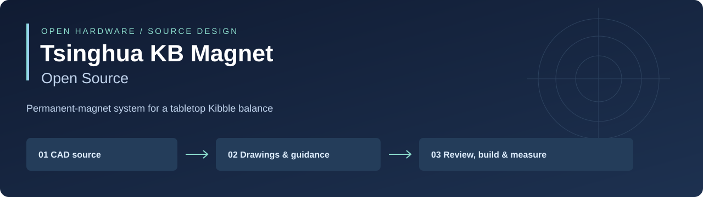

# Tsinghua KB Magnet Open Source



**CAD, engineering drawings, and practical documentation for the permanent-magnet system of the Tsinghua tabletop Kibble balance.**

This repository packages the supplied A5 magnet design snapshot, `KB_Standard_A5磁组20261110`, for inspection, adaptation, and reproducible distribution. It includes native SolidWorks source files, available STEP models, PDF manufacturing drawings, an English engineering guide, and publication tools.

The scientific reference is [*A Compact Magnet System for the Tsinghua Tabletop Kibble Balance*, Ma et al., arXiv:2409.03334v1](https://arxiv.org/abs/2409.03334v1). Read the [paper fact sheet](docs/PAPER_FACTS.md) for its key parameters and reported results, and the [technical guide](docs/TECHNICAL_GUIDE.md) for the physical principles and a practical path to reproducing and testing a magnet.

**Release status:** a documented source-design snapshot. Native CAD rebuilds, assembly dependency resolution, fabrication, and magnetic performance have not been independently verified for this snapshot. The original filenames and Chinese drawing annotations are preserved; the accompanying documentation is in English.

## Start here

| Your task | Entry point |
| --- | --- |
| Understand the design and measurement principles | [Technical guide](docs/TECHNICAL_GUIDE.md) |
| Find the article's design values and experimental outcomes | [Paper fact sheet](docs/PAPER_FACTS.md) |
| Browse every supplied CAD file and drawing | [File index](docs/FILE_INDEX.md) |
| Open the assembly or import STEP geometry | [CAD guide](docs/CAD_GUIDE.md) |
| Prepare a supplier enquiry or fabrication review | [Manufacturing guide](docs/MANUFACTURING.md) |
| Plan field mapping and acceptance measurements | [Validation guide](docs/VALIDATION.md) |
| Publish this project to your GitHub account | [Publication guide](docs/PUBLISHING.md) |
| Understand source history and reuse permissions | [Provenance](docs/PROVENANCE.md) and [licensing](docs/LICENSING.md) |

## Open the hardware

1. Download or clone the whole repository. Extract ZIP downloads before opening CAD.
2. In SolidWorks, open [`01.THUKB-CY-01-00 M磁组.SLDASM`](hardware/solidworks/01.THUKB-CY-01-00%20M磁组.SLDASM) from `hardware/solidworks/`. Keep its neighboring part files together.
3. Resolve missing references explicitly and record the result. Do not substitute the similarly named drawing-folder parts without checking geometry and revision.
4. Without SolidWorks, inspect the available part-level STEP files and PDF drawings in [`hardware/drawings/`](hardware/drawings/). The supplied source set does not include a neutral-format assembly model.

File counts, SHA-256 digests, and original source paths are recorded in [`metadata/file-manifest.json`](metadata/file-manifest.json) and its [CSV companion](metadata/file-manifest.csv). Moving files into the repository did not rename or edit the hardware payload.

## Review before fabrication

Inspection of the supplied drawings identified material and revision questions that remain visible in this release:

- The `A5_SmCo` magnet-ring PDF specifies **NdFeB M50**, despite its filename.
- The yoke drawings specify **DT4**; compare the selected procurement grade with the research reference and your magnetic acceptance requirements.
- The upper/lower fixture PDFs are titled **V2.0**, while their supplied assembly-folder native filenames contain **V1.0**.

The [manufacturing guide](docs/MANUFACTURING.md) records the evidence and the decisions needed before ordering. The original files are preserved for traceability.

## Publish to GitHub

On Windows, double-click **[`Publish-to-GitHub.cmd`](Publish-to-GitHub.cmd)**. The launcher prepares the required command-line tools when supported, checks the hardware payload, guides you through GitHub authentication if needed, and creates the repository under your authenticated account. Internet access and permission to create a repository are required. The default GitHub repository slug is **`Tsinghua-KB-Magnet-Open-Source`**; the human-readable project title remains **Tsinghua KB Magnet Open Source**.

For a preview without network access or publication:

```powershell
powershell -NoProfile -ExecutionPolicy Bypass -File .\scripts\publish.ps1 -DryRun
```

Owner, repository-name, and visibility options are described in the [publication guide](docs/PUBLISHING.md). The included scripts have been prepared for publication; this source package itself does not imply that a GitHub repository has already been created.

## Verify or package locally

With Python 3.9 or later, from this repository's root:

```console
python scripts/validate.py
python scripts/make_release.py
```

Validation checks the supplied hardware against its manifest and checks local documentation links. Packaging creates a distributable ZIP outside the repository. GitHub Actions runs repository checks on pushes and pull requests; see the [publication guide](docs/PUBLISHING.md) for release automation.

## What this source release provides

- The native assembly and its supplied companion parts, retained in one directory.
- The original drawing-directory payload, including available neutral CAD and manufacturing PDFs.
- A file-by-file index with English descriptions and explicit revision caveats.
- Engineering notes connecting magnetic-circuit behavior to measurement requirements.
- A proposed build-review and measurement workflow, with record templates.
- Checksums, citation metadata, contribution guidance, and repeatable publication tools.

The [provenance record](docs/PROVENANCE.md) identifies the boundary between supplied files, published research, and newly written guidance. In particular, this repository is a magnet-system release, rather than a complete Kibble balance implementation. Coil, motion, electrical standards, control, field-map data, and a complete uncertainty budget must be established for the instrument being built.

## Cite the work

Please cite the research article when discussing the magnetic design or its published measurements. A machine-readable [CITATION.cff](CITATION.cff) and [BibTeX entry](references/paper.bib) are included. For a derived design, also identify the repository commit or release tag and describe your changes. The repository title credits the design context; it does not assert institutional endorsement of a derivative implementation.

## Contribute and reuse

See [CONTRIBUTING.md](CONTRIBUTING.md) for design changes, measurement reports, and issue submissions. Retain the hardware directory structure and update the manifest when intentionally revising the source payload.

Hardware is released under **CERN-OHL-P-2.0**, original repository documentation under **CC-BY-4.0**, and publication/validation tooling under **MIT**. The article remains under its own terms and is linked, not redistributed. See [LICENSE](LICENSE) and [docs/LICENSING.md](docs/LICENSING.md) for the complete scope.
